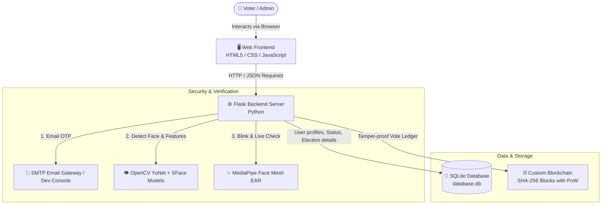
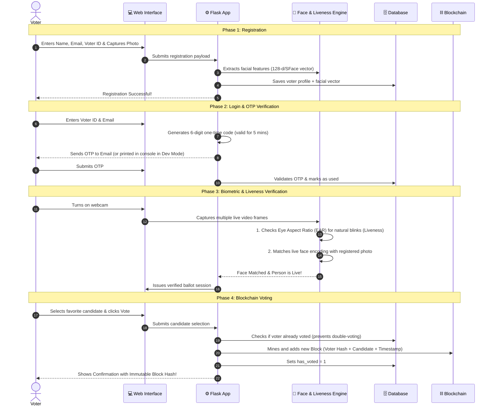

# 🗳️ SecureVote — Online Voting System (Complete Guide & Plan)

Welcome to **SecureVote**! This document provides a complete, easy-to-understand breakdown of how this secure online voting system is designed, how every component works behind the scenes, and how all the security layers fit together.

---

## 🌟 What is SecureVote?

**SecureVote** is a next-generation web application designed to conduct fair, tamper-proof, and verifiable online elections. It prevents voter fraud and unauthorized access by combining:
1. **Multi-Factor Authentication (MFA)**: Email OTP + Biometric Face Recognition.
2. **AI Anti-Spoofing (Liveness Detection)**: Verifies that the voter is physically present and alive (not holding a photo or video).
3. **Decentralized Trust (Blockchain)**: Stores cast votes in an immutable, cryptographic chain where no one—not even an administrator—can modify or delete past votes.

---

## 🏗️ System Architecture & How Components Connect



---

## 🔄 Step-by-Step Workflow: How a Vote is Cast

Here is the exact journey from voter registration to receiving a tamper-proof vote receipt:



---

## 🔍 Deep Dive: Core Technologies & Mechanisms

### 1. 📧 Multi-Factor Authentication (MFA) with OTP
- When a voter initiates login, a cryptographically secure 6-digit OTP is generated.
- The OTP is timestamped with an expiration window (5 minutes).
- Once entered correctly, the OTP is invalidated (`used = 1`) to eliminate replay attacks.
- *Dev/Test friendly*: If SMTP credentials are not configured, OTPs are safely logged to the terminal so testing is effortless.

### 2. 👁️ OpenCV YuNet & SFace Face Recognition
- **Face Detection (YuNet)**: A high-performance lightweight deep neural network model that locates faces in the webcam feed instantly with bounding boxes and landmark points.
- **Face Feature Extraction (SFace)**: Converts human facial features into high-dimensional numerical vectors.
- **Cosine / Euclidean Matching**: When the voter logs in, their current face vector is mathematically compared against the vector stored at registration. If the difference is below the strict tolerance threshold, the identity is confirmed.

### 3. 👁️‍🗨️ Liveness & Anti-Spoofing Detection
- Prevents malicious users from holding up a printed photo or smartphone video to fool the camera.
- Uses facial landmarks to calculate the **Eye Aspect Ratio (EAR)** across successive frames.
- Analyzes natural micro-movements and blink events to ensure the voter is live in real-time.

### 4. ⛓️ SHA-256 Blockchain Ledger
Each vote cast creates a cryptographic block with:
- **Block Index**: Serial number of the vote in the election.
- **Timestamp**: Exact UTC epoch time the vote was registered.
- **Vote Data**: Anonymized voter ID hash (`SHA-256(voter_id)`), Candidate ID, Candidate Name, and Election ID.
- **Previous Hash**: The cryptographic hash of the prior block, creating a single unbreakable chain.
- **Nonce & Proof of Work**: A lightweight mining requirement ensuring block integrity.
- **Tamper-Proof Guarantee**: If anyone attempts to alter a candidate name in an old block, the hash changes, invalidating every subsequent block in the chain instantly.

---

## 🗄️ Database Structure (`database.db`)

| Table Name | Purpose | Key Columns |
| :--- | :--- | :--- |
| `voters` | Registered voters list | `id`, `name`, `email`, `voter_id`, `face_encoding` (BLOB), `has_voted` (0/1) |
| `otps` | Temporary one-time passcodes | `id`, `email`, `otp`, `created_at`, `expires_at`, `used` |
| `elections` | Active/Past election contests | `id`, `title`, `is_active`, `created_at` |
| `candidates` | Nominees running in elections | `id`, `name`, `party`, `election_id` |
| `votes` | Audit index for cast votes | `id`, `voter_id`, `block_hash`, `voted_at` |

---

## 🛡️ Administrative Controls (`/admin`)

The system includes a dedicated administrative portal:
- **Admin Dashboard**: Real-time voter turnout counter, total ballots cast, and active election status.
- **Voter Registry Manager**: View registered voters, check voting status, or remove test records.
- **Blockchain Explorer**: Live interactive block visualizer showing block index, timestamp, data payload, previous hash, and block validity validation.
- **Election Reset & Management**: Start new elections, configure candidates, and reset chains safely for new voting cycles.

---

## 🚀 How to Run and Test the Application

### 1. Install Dependencies
```bash
pip install -r requirements.txt
```

### 2. Start the Flask Server
```bash
python app.py
```
*The web server will start at `http://127.0.0.1:5000`.*

### 3. Step-by-Step Test Procedure
1. Open your browser and navigate to `http://127.0.0.1:5000`.
2. Click **Register as Voter** -> Fill in your Name, Email, Voter ID, and capture your face using the webcam.
3. Click **Vote Now** -> Enter your Voter ID and Email.
4. Check your terminal/email for the 6-digit OTP and enter it on screen.
5. Complete the live face verification test by looking into the webcam and blinking naturally.
6. Select your candidate on the ballot and click **Cast Vote**.
7. Receive your official **Blockchain Transaction Receipt**!
8. View live statistics and blockchain verification at `http://127.0.0.1:5000/results` or log in as Admin (`admin` / `admin123`) at `http://127.0.0.1:5000/admin/login`.

---

## 📋 Summary of File Responsibilities

| File | Role |
| :--- | :--- |
| [app.py](file:///c:/Users/balaji/Desktop/online-voting-system-project/app.py) | Main controller, routing, session management, database queries, and API endpoints. |
| [blockchain.py](file:///c:/Users/balaji/Desktop/online-voting-system-project/blockchain.py) | Implementation of the `Block` and `Blockchain` classes, SHA-256 hashing, mining, and tallying. |
| [face_utils.py](file:///c:/Users/balaji/Desktop/online-voting-system-project/face_utils.py) | OpenCV YuNet & SFace models, landmark calculation, blink liveness detection, and image decoding. |
| [database.db](file:///c:/Users/balaji/Desktop/online-voting-system-project/database.db) | SQLite database containing voter records, elections, candidates, and OTP records. |
| [templates/](file:///c:/Users/balaji/Desktop/online-voting-system-project/templates) | Jinja2 HTML templates for voter registration, login, verification, voting, and admin screens. |
| [static/](file:///c:/Users/balaji/Desktop/online-voting-system-project/static) | Styling, UI animations, webcam capture scripts, and client-side validations. |
